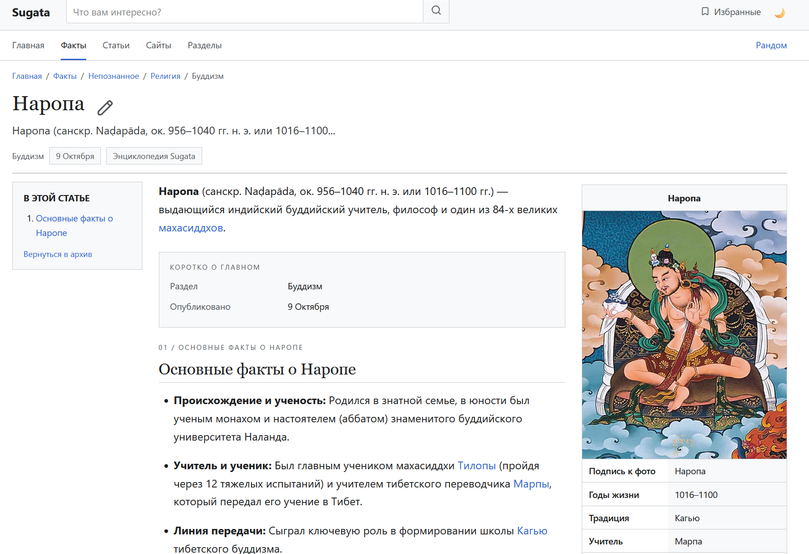
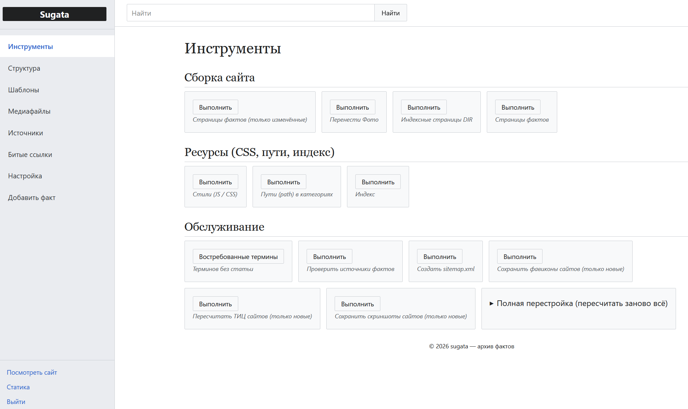

<p align="center">


</p>

<p align="center">
  <b>English</b> · <a href="./README.ru.md">Русский</a>
</p>

# Sugata

A static wiki for a personal fact site: articles are written in the admin panel and then **built into standalone HTML files** to be served with no PHP in production.

The project is a fork of [LibArea/Sugata](https://github.com/LibArea/Sugata), reworked around an encyclopedia model: version history, auto-links between articles, backlinks and broken-link checking.

## Features

- **Static build** of every article as `{category}/{slug}.html`, categories as `index.html`/`page-N.html`, plus `sitemap.xml` and a shared `footer.shtml`.
- **Incremental rebuild** — only changed facts and the categories/home that depend on them are updated.
- **Version history** — a snapshot of the state before each edit (content, slug, metadata); view any version and **roll back** to it.
- **Auto-links `[[Term]]`** — wiki markup resolved to a blue link on an unambiguous match, or to a red "create" link when the article does not exist (in the admin/preview).
- **Backlinks “What links here”** — a list of articles that link to the current one.
- **Broken-link checking** — a report of broken `[text](/url)` and uncreated `[[Term]]` links.
- **Search** with Russian/English morphology (S2\Rose, Porter stemmer).
- **CommonMark markup** (+ GFM extensions: tables, footnotes, task lists, strikethrough) with dangerous HTML escaped.






## Tech stack

- PHP 8.2+
- MySQL 8 / MariaDB 10.2.2+
- Framework [HLEB](https://github.com/phphleb/hleb) (2.x)
- Parser [league/commonmark](https://github.com/thephpleague/commonmark) (CommonMark/GFM)
- Search [S2\Rose](https://github.com/s2ware/rose)

## Structure

```
config/            settings (general, database, main, meta...)
routes/map.php     routes (admin panel + preview)
app/
  Controllers/     controllers (build, articles, history, rollbacks...)
  Models/          DB layer (ItemModel, VersionModel, BacklinkModel...)
  Content/         Parser (CommonMark + wiki links), Html, Meta, Img, Validator
  helpers.php      global functions
resources/views/   templates (admin, front-end, shared components)
public/            entry point, assets (built into static output)
scripts/dev.sql    DB schema and test data
wiki-view.local/   BUILD OUTPUT (static site)
```

## Installation

```bash
composer install
```

1. Create a database and import the schema: `scripts/dev.sql` (includes the structure and test data).
2. Set the connection in `config/database.php` (or `config/database-local.php`).
3. Configure `config/general.php`: `url` (admin), `url_html` (public static address), `path_html` (build folder).
4. Point a web server at the `public/` folder.

### Admin login (test accounts)

- Administrator: `ss@sdf.ru` / `qwer14qwer14`
- User: `test@test.ru` / `test@test.ru`

Admin panel: `https://<url>/mod/admin/`

## Building the static site

In the admin panel (menu **Tools**) run in order:

1. **Rebuild assets** — build CSS/JS (Minify) from sources.
2. **Category paths** — recalculate `facet_path`.
3. **Create directories** — category folders.
4. **Build category HTML pages** — `index.html`/`page-N.html` for each category.
5. **Build fact HTML pages** — each article into its own `.html`.
6. **Update search index** — rebuild the morphological index.
7. **Sitemap** — generate `sitemap.xml`.
8. **Check sources/broken links** — HEAD checks on sources and a scan for broken/uncreated links.

> **Incremental build** — rebuilds only the changed facts and dependent categories/home; useful after edits when a full rebuild is not needed.

## Wiki markup

Both linking styles are supported inside articles:

| Syntax | Result |
|---|---|
| `[[Dzogchen]]` | Auto-link. Unambiguous match → blue; none/ambiguous → red (in the admin) |
| `[[Text\|Dzogchen]]` | Same, but with arbitrary link text |
| `[[Text\|/path/slug.html]]` | Explicit exact link to a specific URL |
| `[text](/path/slug.html)` | A regular markdown link (not checked by the engine) |
| `:::{.foto}` … `:::` | Block container with a class (photo with caption, notes) |
| `[^1]` and `[^1]: text` | Footnotes (gathered into a “Notes” block) |

Red and broken links are gathered in the **Broken links** report (`/mod/admin/broken-links`).

## Database (key tables)

- `items` — facts/articles/pages.
- `facets`, `facets_items_relation` — the category tree and the article↔category relation.
- `item_history` — **version history** (a snapshot before each edit; rollbacks and viewing).
- `item_relations` — manual “related articles” links (both directions).
- `sources`, `article_sources` — fact sources and their bindings.
- `broken_links` — the broken/uncreated-link report.
- `item_faq` — “question–answer” blocks.
- `users` — users and permissions.

## License

MIT. See [LICENSE](LICENSE).